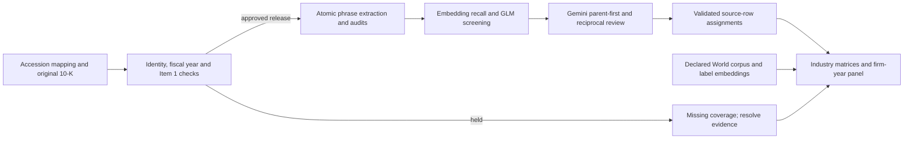

# System Activities

A research pipeline that turns verified SEC 10-K **primary Item 1** text into atomic activity phrases, assigns those phrases to a frozen activity taxonomy, audits assignments with Gemini, and builds firm-year matrices by industry.

**Status (2026-10-25): the five-stage implementation is packaged and can be run from explicit inputs. Offline checks cover source gates, assignment/review logic, cached resume, and matrix arithmetic. A fresh-checkout live end-to-end run has not been certified, and the PARCC production runs are not complete across all industries.** See [reproducibility and validation limits](docs/REPRODUCIBILITY.md). Model judgments are not deterministic scientific ground truth.

This update preserves the repository's history and the original `Empirical_explore/` code and tracked artifacts. Its original documentation is retained in [README_original.md](Empirical_explore/README_original.md). The current workflow lives alongside it; historical exploratory output is not automatically an approved input to this workflow.



| Stage | Entry point | Completion evidence |
|---|---|---|
| Verify 10-Ks | [`scripts/prepare_extraction.py`](scripts/prepare_extraction.py) | Frozen approved manifest, source packets, held-coverage inventory |
| Extract phrases | [`scripts/run_extraction.py`](scripts/run_extraction.py) | Per-report receipt, strict stage output hashes, technical QA |
| Assign with GLM | [`pipeline/assignment/scripts/prepare_run.py`](pipeline/assignment/scripts/prepare_run.py), `run_stage.sh … glm` | Every recalled pair resolved; `GLM_COMPLETION_GATE_PASSED` |
| Audit with Gemini | `run_stage.sh … gemini` | Both review directions agree; final validation complete, zero unresolved |
| Build industry matrix | [`scripts/matrix.py`](scripts/matrix.py) | Coverage and provenance checks; numeric and workbook-cell validation |

## Start without API calls

Use Python 3.12–3.14 in a new environment. The local release was tested with Python 3.14; the included CI matrix targets Linux 3.12 and 3.14.

```bash
python3 -m venv .venv
source .venv/bin/activate
python -m pip install -r requirements.txt
python -m pip check
python scripts/check_offline.py
```

The tests use synthetic filings and fake model responses. They exercise the real local processing and validation code without credentials or scheduler submission. spaCy uses a blank English pipeline; no language-model download is needed. Never use Python `-O`, which disables assertions used by the inherited validators.

For a small, entirely offline prepared assignment run:

```bash
python pipeline/assignment/scripts/prepare_run.py \
  --source pipeline/assignment/examples/phrases.csv \
  --taxonomy pipeline/assignment/examples/taxonomy.csv \
  --industry demo --identity-version synthetic_example \
  --output runs/demo_assignment --workers 2 --budget-cap-usd 1 \
  --recall-policy top1000 --confirm-verified-source
python runs/demo_assignment/work/run_glm_only.py --offline
```

This prepares and validates inputs; it does not classify them. Full execution commands, credential handling, and Slurm examples are in the [runbook](docs/RUNBOOK.md).

## Data and methods

- Supply a reviewed historical issuer/accession mapping, original filings or official SEC document URLs, and a declared World corpus. Neither private research inputs nor live run caches are bundled.
- The repository includes **19,587 frozen parent definitions**, projected to the exact fields consumed by assignment. Membership history is a separate matrix input; see [taxonomy provenance](docs/taxonomy_provenance.json).
- New runs default to the recent recall rule: maximum similarity **strictly greater than 0.33**, intersected with the global top 1,000 parents. Explicit `--recall-policy legacy` reproduces the earlier inclusive `>= 0.33`, uncapped candidate rule. Record the policy when comparing runs.
- GLM sees context for phrases of at most four words; Gemini uses context for fewer than four words. Gemini reviews GLM-kept candidates **union** the mandatory embedding top 30, then accepts only parent-first/phrase-reciprocal agreement.
- Matrix zeros for missing firm-years are labeled placeholders and excluded from metrics. “New to World” means first observed within the declared corpus. It does not establish invention.

Read the [data contracts and methods](docs/CONTRACTS.md), [authentication and request flow](docs/AUTHENTICATION.md), and [reproducibility assessment](docs/REPRODUCIBILITY.md) before interpreting results.

## Layout

- `Empirical_explore/`: original exploration, preserved.
- `pipeline/extraction/template/`: deployed PARCC extraction code and prompts, copied into each isolated run.
- `pipeline/assignment/`: portable embedding, GLM, Gemini, export code, and frozen taxonomy.
- `scripts/`: source preparation, stage handoffs, World construction, matrix build, and offline checks.
- `docs/`: methods, deployment, provenance, and validation boundaries.
- `tests/`, `pipeline/assignment/tests/`: synthetic verification.

Generated runs, credentials, filings, model responses, and workbooks are excluded from new commits by `.gitignore`. Keep full run directories and ledgers together for resumption. Prepare at the final deployment path; frozen absolute paths make a prepared run unsuitable for casual relocation.
